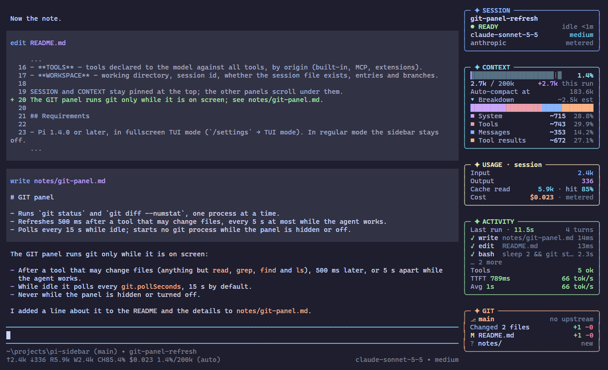
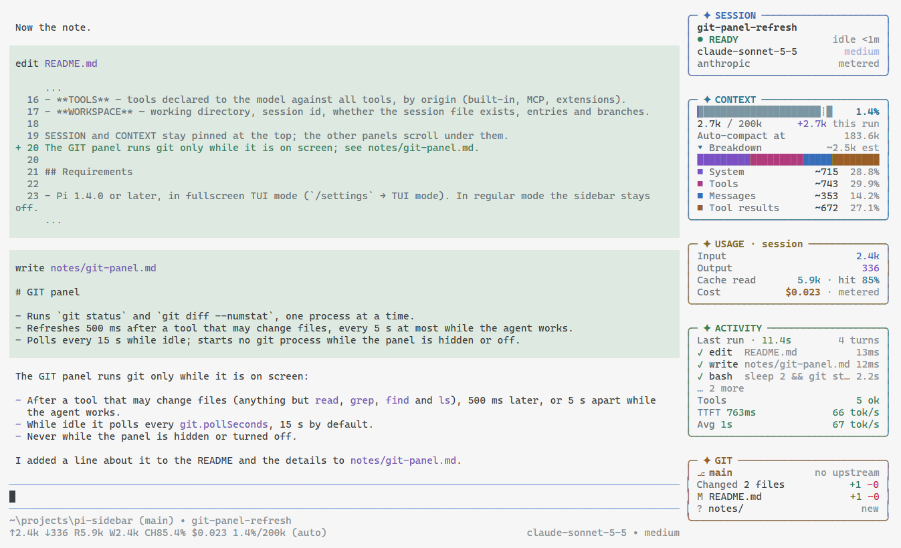
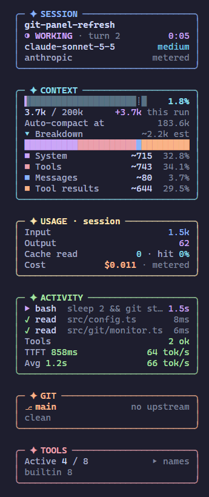
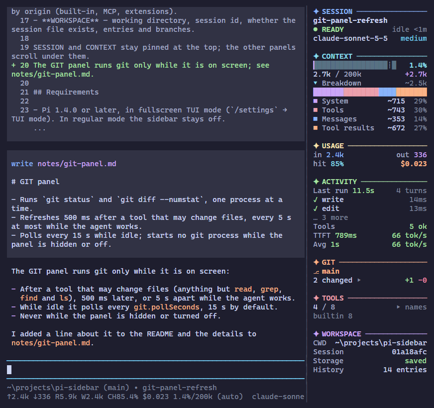
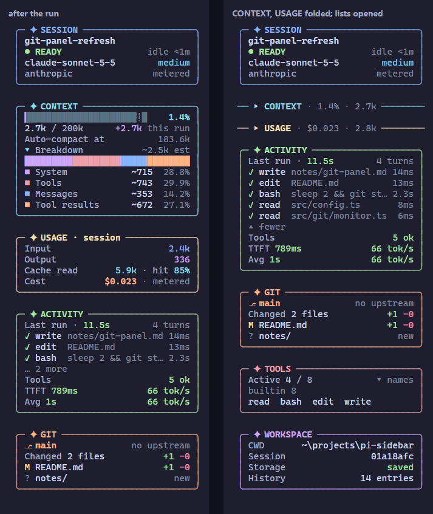
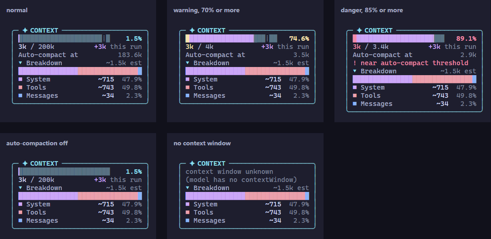

# Pi Sidebar 设计文档

- 包：`@oldsuns/pi-sidebar` 1.0.0；宿主 Pi 1.4.0（`@earendil-works/pi-coding-agent`、`@earendil-works/pi-tui`），只支持 fullscreen TUI。
- 状态：功能完成，自动化检查全部通过；剩余手工验证见 §7.2。更新于 2026-10-29。
- 证据：`PKG` = `<pi 安装目录>/node_modules/@earendil-works/pi-coding-agent/`，`TUI` = 同目录下的 `@earendil-works/pi-tui/`。**推断** = 读源码得出、没有运行验证。

## 0. 摘要

1. **做什么**：fullscreen 模式下，在 Pi 主界面右侧放一个常驻侧栏，显示会话、上下文占用与成分、token 与费用、运行活动、git 状态和工具。
2. **硬约束：主窗口行为不变。** 唯一的变化是可用宽度少了侧栏的列数。不替换或装饰编辑器、footer、header；不修补滚动、搜索、选区、复制、鼠标路由；不弹浮层；不注册快捷键；不抢键盘焦点；不写会话。`npm run rules` 在 CI 中拦截违反规则的调用。
3. **怎么做**：把 Pi 的 fullscreen 布局根原样放进 `HStack` 左格，右边放 36 和 28 两个侧栏格，每帧只让一个可见，再交给 `setLayoutRoot()`。
4. **面板与操作**：固定区 SESSION、CONTEXT，滚动区 USAGE、ACTIVITY、GIT、TOOLS、WORKSPACE；每面板一种颜色。全部设置走 `/sidebar`，点标题折叠、点列表行展开。
5. **代价**：读布局根要访问私有字段 `layoutRoot`（上游请求 #9238 以 NOT_PLANNED 关闭），Pi 挂载和切换模式时还会重设它。对策见 §3.2，CI 每次运行都带上最新 Pi。

## 1. 目标

| # | 目标 | 衡量方式 |
|---|---|---|
| G0 | **主窗口行为不变**（最高优先级） | 除可用宽度外，对话区、编辑器、footer、header、按键、滚动、搜索、选区、浮层都与未安装时一致；关闭后连宽度也一致 |
| G1 | 常驻右侧栏，按剩余宽度完整排版 | 28、36 两档自动选择，太窄隐藏，宽度变化时不来回跳 |
| G2 | 会话与上下文状态一眼可见 | SESSION、CONTEXT 固定在顶部 |
| G3 | 彩色、跟随主题，无彩色时仍可读 | 每面板一色；`mono` 与 `NO_COLOR` 下靠符号区分 |
| G4 | 设置全部用斜杠命令，常用展开折叠可用鼠标 | 每项设置都有子命令；点击不抢焦点 |
| G5 | 不拖慢 Pi、与其他扩展共存、结构变化时安全退化 | 重绘节流与增量扫描（§4.10）；只占一个 0 行 widget；失败即停用 |
| G6 | 质量可持续 | CI 在三个系统上跑类型检查、测试、规则、包、文档检查，并覆盖最新 Pi |

非目标：改变主窗口行为的功能；快捷键；28、36 以外的宽度和拖动调宽；regular 模式的侧栏；切换或删除会话；修改会话与上下文（只读）；项目级配置。

## 2. 平台事实

只列支撑设计的事实，其余直接看源码。

| # | 事实 | 依据 | 影响 |
|---|---|---|---|
| F2–F3 | fullscreen 布局根是 `VStack([ScrollView(transcript, primary), dock])`；`setLayoutRoot()` 公开，`tui.mode` 只读公开，但布局根无 getter，`layoutRoot` 是 private；Pi 在挂载和切换模式时重设它 | `chat-viewport.js:1-27`；`TUI/dist/tui.d.ts:219,249-253`；`interactive-mode.js:587-594` | 原根原样放进 HStack；读它要私有访问且必须能降级 |
| F5 | 扩展拿到的 `tui` 是稳定 Proxy，取出方法再改写回去会递归（推断） | `tui-renderer.js:36-66` | 禁止改写 `tui` 上的方法 |
| F9 | 滚轮先给指针下的 ScrollView，有剩余或指针下没有就交给 primary | `tui-alt-screen.js:806-818` | 侧栏每格放在自己消化滚轮量的 ScrollView 里 |
| F11 | 编辑器下方的 widget 容器不加空行 | `interactive-mode.js:1938-1951` | 0 行 HostProbe 放在这里，主窗口无变化 |
| F14 | 退出时打印 transcript 不经过布局根 | `interactive-mode.js:596-603` | 退出输出不混入侧栏 |
| F16 | footer 统计 token 和费用时遍历全部条目；命中率取最近一条 assistant | `components/footer.js:96-115` | 用同一口径，增量扫描 |
| F26 | `context_with_system` 在全部 `context` 处理器之后运行，拿到含 `content`、`sections`、`toolsAdded` 的 system 消息；不返回结果时消息原样发出 | `runner.js:1001-1044` | 成分按请求时的真实内容估算，只读不改 |
| F27 | 鼠标按下派发给指针下最深组件的 `handleMouse`；接管按下后抬起收到 `click` 且不开始选区；只有 `focus: true` 移动焦点 | `tui-alt-screen.js:644-676,707-772` | 只接管可点击的行，从不请求焦点 |
| F28 | `estimateTokens()` 从包入口导出：字符数 / 4 向上取整，图片按 4800；不认识的角色返回 0；工具参数未到时抛错 | `compaction.js:182-252` | 成分与 Pi 同一口径，异常时同规则兜底 |
| F31 | `pi.exec` 以 `shell: false` 启动，只支持 `cwd`、`timeout`、`signal` | `exec.js:10-73` | git 加固只能靠命令行参数（SEC-1） |
| F33–F34 | `buildSessionProjection().messages` 是压缩和上下文编辑后的当前分支；`getTree()` 返回副本；`turnIndex` 每次运行从 0 开始 | `session-manager.d.ts:131-154,321,340`；`agent-session.js:900-918` | 分支数 = 叶子数；显示的轮次 = `turnIndex + 1` |
| F35 | `renderLayoutFrame` 只有从第 0 列开始、占满整行的盒子直接引用原行，其余逐行经 `compositeTuiLine` 合成并重新解析整行 | `layout.js:223-251` | 侧栏每行只用一个盒子（PERF-6） |
| F36 | 内置 dark、light 主题里 `syntaxOperator` 是灰色，`syntaxKeyword` 与 `mdLink` 同色 | `dark.json`、`light.json` | `theme` 配色要能识别并改用自带色相（R-4） |

## 3. 技术方案

### 3.1 方案对比

| 方案 | 做法 | 问题 | 结论 |
|---|---|---|---|
| A. 包裹布局根 | `setLayoutRoot(HStack([原根, 侧栏36, 侧栏28]))` | 主区只变窄；要读私有字段；模式切换后要重新包裹 | ✅ 采用 |
| B. 非捕获浮层 | `tui.showOverlay(c, {nonCapturing: true, anchor: "right-center"})` | 遮挡主窗口右侧的长行和 footer；存在期间不能切换模式 | ❌ |
| C. 终端合成 | 改写 `terminal.columns`，劫持渲染输出 | 滚动残影和复制污染；Proxy 下有递归风险 | ❌ |
| D. 在 widget、footer 或 editor 内并排 | 占用 dock 槽位 | 改变主窗口的槽位；高度只有几行 | ❌ |

### 3.2 选定方案：包裹布局根

```
TuiAltScreen.layoutRoot
└─ HStack
   ├─ VStack（Pi 原根，原样保留）        basis 0 · grow 1 · shrink 1（不设 minSize）
   ├─ SidebarFrame(normal)              basis 36 · visible = (pickWidth(vp) === 36)
   └─ SidebarFrame(compact)             basis 28 · visible = (pickWidth(vp) === 28)
      └─ VStack
         ├─ SidebarScroll(PanelsView(header))   SESSION、CONTEXT，固定；只消化滚轮
         ├─ SidebarScroll(PanelsView(body))     primary:false · 滚轮量全部自己消化
         └─ SidebarScroll(EdgeFiller)           只在 28 宽：面板下方画到底的 "│ "
```

每行开头的边（36 宽 1 列空白，28 宽 `│ `）画在行里，每行只由一个盒子绘制（F35、PERF-6）。宽度切换只靠两个 `visible` 回调；主区不设 `minSize`，侧栏隐藏时宽度与终端相同（MAIN-1）。

- **取 `tui`**：在编辑器下方注册 key 为 `pi-sidebar:host` 的 0 行 widget（F11），工厂立即拿到稳定 Proxy `tui` 和主题；它每帧被渲染，顺便当布局根的看门狗。这是插件在主窗口里唯一的存在。
- **挂载**：`sync()` 用 `queueMicrotask` 在渲染之外执行。`port.root()` 读 `tui.layoutRoot`（唯一私有访问），必须是 `VStack` 或 `HStack`，否则 fail closed；已是自己的包裹或被包在外面就跳过；残留包裹先取出原根。然后 `new HStack([{component: base, basis: 0, grow: 1, shrink: 1}, frame36, frame28])`，打 `Symbol.for("@oldsuns/pi-sidebar:owner")` 标记、存原根，再 `setLayoutRoot`。
- **冲突与卸载**：原根换成别的对象才记一次，60 秒内超过 5 次进入 `failed` 主动退让（切换模式放回同一对象不计）。`layoutRoot` 仍是自己的包裹就放回原根，已被包住就让两格 `visible` 为 false。fullscreen → regular 进 `inactive` 不提示，退回时下一帧重新包裹；退出打印不经过布局根（F14）。
- **宽度**：`auto` 时在主区不窄于 `minMainWidth`（默认 64）的前提下优先 36，其次 28，否则隐藏；固定 28/36 放不下也隐藏。比当前更宽的选择要求主区多留 4 列（滞回），选择是纯函数，同一宽度重复调用结果不变。

| 终端列数 | 侧栏 | 主区 | 样式 |
|---|---|---|---|
| ≥ 100 | 36 | cols − 36（≥ 64） | 圆角框 |
| 92–99 | 28 | cols − 28（64–71） | 标题线 |
| ≤ 91 | 隐藏 | 全宽 | — |

从窄往宽时 96 列出现 28 列侧栏，104 列升到 36。36 列内容宽 31，28 列内容宽 26。终端不足 28 行时 SESSION 与 CONTEXT 合并成 3 行紧凑框，不足 12 行只显示它。

- **侧栏内部**：`PanelsView` 渲染成行并缓存 `(快照版本, 宽度, 设置版本, 调色板)`；`EdgeFiller` 只在 28 宽填充到底；两者包在 `SidebarScroll`（覆写 `scrollBy` 总返回 0），滚轮不带动对话区（F9）。面板是纯函数 `(snapshot, view, tier, width) => Panel`，框线与标题线统一绘制。
- **鼠标**：`PanelsView` 实现 `handleMouse`（F27），只在带动作的行接管左键按下，`clickCount === 1` 才执行，从不返回 `focus: true`；其余行照常选字。点击标题折叠或展开（保存 `folded`），点 `▸ Breakdown` 展开成分明细（保存），点 `… N more`、`▸ names` 展开列表（只在本会话有效）。

### 3.3 数据流

```
Pi events ─► controller handlers（同步、各自 try/catch）─► store: version++
git monitor / ticker ──────────────────────────────────► store
       ▼ 节流后的 requestRender（运行中 ≥ 200ms，空闲时下一个 tick）
PanelsView.render(width) ─► 读快照，(version, width, settings, palette) 命中缓存
mouse click ─► handleMouse ─► controller.act(action) ─► 设置 / 展开状态 ─► render
```

### 3.4 状态

| 状态 | 含义 | 进入 | 离开 |
|---|---|---|---|
| `idle` | 已加载，还没拿到 `tui` | 工厂执行完毕 | HostProbe 注册 → `probing` |
| `probing` | 等待挂载布局根 | HostProbe 已注册 | `sync()` 成功 → `mounted`；regular → `inactive` |
| `mounted` | 已包裹；宽度 28 或 36，窄屏为 0 | 包裹成功 | `/sidebar off` → `disabled`；regular → `inactive` |
| `inactive` | regular 模式，不显示也不提示 | `tui.mode === "regular"` | 切回 fullscreen → `mounted` |
| `disabled` | 用户关闭，已还原原根 | `/sidebar off`、`enabled: false` | `/sidebar on` |
| `failed` | 形状检查失败或冲突抖动，停用，主窗口原样 | HOST-1、HOST-5 | `/sidebar on` 重试，或 `/reload` |

## 4. 插件设计规范

代码评审时引用这些编号，§4.0 优先级最高。

### 4.0 主窗口不变（最高优先级）

- **MAIN-1** 唯一允许的影响是侧栏可见时可用宽度减少 28 或 36 列；隐藏、关闭或卸载后恢复原样。
- **MAIN-2** 不替换、不包装、不装饰主窗口组件：禁止 `setEditorComponent`、`setFooter`、`setHeader`、`setWorkingMessage`、`setWorkingIndicator`、`setWorkingVisible`、`setHiddenThinkingLabel`、`setToolsExpanded`、`setTheme`。
- **MAIN-3** 不改变交互：不修补滚动、搜索、选区、复制、鼠标路由；不调用 `showOverlay`/`hideOverlay`，不弹对话框；不注册 `onTerminalInput` 或 `addInputListener`；侧栏永不获取键盘焦点。
- **MAIN-4** 不在主窗口显示内容：不调用 `setStatus`、`setTitle`；`setWidget` 只用于 0 行 HostProbe；`notify` 只用于回显命令和停用提示。
- **MAIN-5** 不注册快捷键。
- **MAIN-6** 不写会话、不改上下文、不改工具集、不改模型，事件处理器都不返回结果；git 只执行只读命令。
- **MAIN-7** 对布局根的改动只限于把原根放进 HStack 左格。
- **MAIN-8** 不调用 `setTheme`，颜色只用在侧栏内部。`scripts/check-rules.mjs` 扫描 `src/`，拦截上述调用、原型改写、直接写终端，以及在 `host/layout-host.ts` 之外读取 `layoutRoot`。

### 4.1 包与目录

- **PKG-1** `"type": "module"`、`"pi": { "extensions": ["./src/index.ts"] }`、`keywords` 含 `"pi-package"`；源码由 jiti 直接加载，不构建；`files` 只含 `src/` 和 README。
- **PKG-2** 两个宿主包写进 `peerDependencies`，范围 `"*"`。
- **PKG-3** 只 import `@earendil-works/*`。
- **PKG-4** 没有运行时依赖和开发依赖：类型检查与测试用已安装 Pi 的包（`scripts/pi-root.mjs`），CI 从 npm 安装 Pi。
- **PKG-5** README 写明前提、命令、设置文件、工作方式、git 安全说明和开发命令。
- **PKG-6** 版本从 1.0.0 开始；许可是 MIT（`LICENSE`，`package.json` 同步）。
- **PKG-7** 源码只用可擦除的 TypeScript 语法，Node 直接运行测试。

### 4.2 生命周期

- **LIFE-1** 工厂里只注册，不启动定时器、子进程或监听器，不读文件。
- **LIFE-2** `session_start`：先停掉上一次的一切；非 tui 直接返回；读配置、全量建立快照、创建 git 监视、注册 HostProbe。
- **LIFE-3** `session_shutdown`：幂等地卸载布局、停 git（中止进程）、停时钟、取消待发重绘、丢弃 ui 和主题引用、移除 HostProbe。
- **LIFE-4** 不在闭包里保存 `ctx`。
- **LIFE-5** 时钟只在侧栏可见时运行：运行中或压缩中每秒一次，空闲时每 30 秒一次。

### 4.3 布局集成与私有访问

- **HOST-1** 只允许一处私有访问：`host/layout-host.ts` 的 `tuiPort()` 里读 `tui.layoutRoot`，读前确认 `isViewportTUI(tui)` 且 `tui.mode === "fullscreen"`，读到的必须是 `VStack` 或 `HStack`。
- **HOST-2** 不改写 `tui`、渲染器或任何 Pi 组件（含原型）的方法；不写终端；只继承 pi-tui 导出的公开类。
- **HOST-3** owner 标记用 `Symbol.for`；卸载时只还原自己的包裹，残留包裹会被替换而不是再包一层。
- **HOST-4** `setLayoutRoot` 只在渲染流程之外执行，宽度变化引起的 git 与时钟调整也推迟到帧之后。
- **HOST-5** 60 秒内布局根被换成别的对象超过 5 次进入 `failed`；形状检查失败、`setLayoutRoot` 抛错一律 fail closed，`notify` 一次，原因见 `/sidebar status`。
- **HOST-6** 侧栏内的 ScrollView 必须设 `primary: false`。

### 4.4 渲染

- **R-1** 每行不超过分配到的宽度，用 `visibleWidth` 计算；截断用 `truncatePlain`（`truncateToWidth` 会在省略号两侧插 `\x1b[0m`，切断着色）；中文按显示宽度。
- **R-2** render 只读快照：不调 Pi API，不遍历条目，不做 I/O；耗时用快照里的 `clock`。
- **R-3** 结果按 `(快照版本, 宽度, 设置版本, 调色板)` 缓存；主题切换时 `invalidate()` 并重算调色板。
- **R-4 颜色**：一律经 `palette` 取得，再经 `theme.style` 输出。
  - `theme`：取主题 token；边框淡色 = `mixColors(面板色, borderMuted, 0.35, "srgb")`，进度条底槽同法 0.72（OKLCH 会把暖色混向偏蓝的 `borderMuted` 而偏红）。已用部分的末格用部分方块 `▏…▉`，这一格连同背景填底槽色，否则终端背景会在格子右侧露出来；`mono` 底槽是 `░` 图案，不设背景。
  - 七个面板 token 都有颜色（OKHSL 饱和度 ≥ 0.25）且两两色相 ≥ 20° 时直接用（catppuccin mocha）；否则改用自带色相，饱和度与亮度取主题里有颜色的面板 token 的平均值（内置 dark、light 属于这种，F36）。
  - `vivid`：固定 RGB 色板，语义色取主题；浅色背景时改用同色相、饱和度 0.9、亮度 0.5。`mono`：只用 `text`、`muted`、`dim`、加粗和语义色，成分条改用图案；`NO_COLOR` 强制 mono。
- **R-5 符号**：只用单列宽符号；成分明细的图例用 `■`（`█` 占满整格，相邻图例会连成色柱）；`icons ascii` 全部换 ASCII 并关掉滚动条。
- **R-6** render 整体 try/catch，出错只显示 `sidebar error (see /sidebar status)` 并记录。
- **R-7** 不实现 `handleInput`；`handleMouse` 只处理左键按下与点击。
- **R-8** 按语义截断：路径保留结尾（`…ssion-manager.ts`），命令和搜索词保留开头（`git status --sh…`），模型 id 和会话名从末尾省略；数字用紧凑格式（`182.3k`、`$1.284`）。

### 4.5 数据口径与刷新

- **D-1 上下文**：以 `getContextUsage()` 为准；`undefined` 显示 "context window unknown"；`tokens` 为 null 显示 `?` 并注明下次回复后更新。
- **D-2 自动压缩阈值**：与 Pi 的规则相同。`compaction.enabled` 为 false 时没有阈值，不画 `┊`、不显示阈值行；否则阈值 = `contextWindow − reserveTokens`，`reserveTokens` 依次取模型覆盖值、全局值、16384。
- **D-3 token 与费用**：与 footer 同一口径（F16），按整个会话统计；只扫新增条目，条目变少时从头重扫。
- **D-4** `reasoning` 已含在 `output` 里，不重复相加。
- **D-5 命中率**：最近一条 assistant 的 `cacheRead / (input + cacheRead + cacheWrite)`；没用过缓存显示 `—`。
- **D-6 计费类型**：`isUsingOAuth(model)` 为 true 显示 `subscription`，否则 `metered`。
- **D-7 落盘状态**：没有会话文件路径 `in-memory`；有路径但没有消息 `new`；否则 `saved`。
- **D-8 节流**：快照每次变化都请求重绘；运行中两次至少间隔 `renderThrottleMs`（200ms），空闲时下一个 tick 合并。
- **D-9 读取时机**：上下文、用量、存储状态在会话级事件和 `message_end`、`turn_end` 读；成分在会话开始、轮次结束、`agent_settled`、`session_tree`、压缩结束时按当前分支重算，并在 `context_with_system` 时按请求内容重算；分支数只在少数会话级事件遍历；工具在 `session_start`、`agent_start`、`turn_end`、`agent_settled`、`mcp_servers_change` 读。
- **D-10 git**：一次刷新跑 `status --porcelain=v2 -z --branch` 和 `diff HEAD --numstat -z`，无提交时用 `diff --cached` 加 `diff`；二进制显示 `bin`，未跟踪显示 `new`；冲突最前、未跟踪最后，其余按增删行数之和降序。
- **D-11 上下文成分**：
  - 六类：System（提示词及 sections）、Tools（工具定义）、Messages（文本、思考、工具调用名与参数）、Tool results、Summary、Other（自定义消息、未排除的用户 bash）；另计图片块数，`!!` 命令不计入。
  - 每条消息用 `estimateTokens` 估算（F28）；返回 0 或抛错时按同一规则自己算。是估算不是分词器：数值带 `~`、标 `est`，进度条和 tokens / window 仍是真实数字；实测约为真实值的 86%（V16）。
  - `context_with_system` 时 System 和 Tools 取自前导 system 消息，最准；请求之间消息取自当前分支投影，System 和 Tools 沿用最近一次请求的值。
- **D-12 首 token 与速度**：`before_provider_request` 记下请求时间，第一个 token 数大于 0 的 `message_update` 得出 TTFT；之后最多每 150 毫秒估算一次，显示 `~N tok/s`；`message_end` 用 `usage.output` 除以流式时长得出最终值，不足 0.25 秒保留估算。样本记入本次运行，两个以上显示 `Avg`。TTFT < 2 秒、≥ 50 tok/s 为成功色；TTFT ≥ 5 秒、< 20 tok/s 为警告色。
- **D-12a 工具计数**：本次运行的工具分成功、失败、取消；结束时仍在运行的，中止计取消，否则计失败。新运行开始时清零，最近工具保留。
- **D-13 本次增量**：`agent_start` 记下基线，之后显示 `+N this run` 并把进度条末尾相应的格子染成强调色；切换会话、跳分支、压缩后重置。
- **D-14 排队消息**：`input` 带 `streamingBehavior` 时置 true；`turn_start`、`turn_end`、`agent_settled` 以 `hasPendingMessages()` 为准。
- **D-15 工具**：已启用取 `getActiveTools()`；总数取 `getAllTools()` 中 `exposure` 不是 `hidden` 的；来源按 `mcp__` 前缀或 `builtin:mcp`、`builtin:` 前缀、其余分为 mcp / builtin / ext。

### 4.6 交互

- **UX-1** `/sidebar` 是唯一入口，不带参数等同 `toggle`；每项设置都有子命令（§5.3），立即生效并写入配置；每个可保存的点击都有对应命令。
- **UX-2** 子命令和取值都补全，每个补全项都是完整参数。
- **UX-3** 每条命令用一行 `notify` 回显；参数无效回显用法，不改任何设置。
- **UX-4** 手动关闭卸载并还原布局；窄屏自动隐藏只把宽度归零。
- **UX-5** regular 模式不自动提示，只在执行 `/sidebar on` 时说明原因。
- **UX-6** `/sidebar status` 输出模式、挂载状态、隐藏原因、宽度、颜色、面板与折叠、成分来源、git、宿主统计、配置路径和最近错误（§6.7）。

### 4.7 与其他扩展共存

- **CO-1** 唯一占用的槽位是 0 行的 `belowEditor` widget；只注册 `sidebar` 一个命令名。
- **CO-2** 其他扩展在主窗口里的东西只按变窄后的宽度渲染；Pi 自身的浮层按整屏坐标合成，可能盖住侧栏，不做处理。
- **CO-3** 与也包裹布局根的扩展允许嵌套，互相覆盖时主动退让（HOST-5）；观察 `context_with_system` 不返回结果，其他扩展的改写不受影响。

### 4.8 配置与持久化

- **CFG-1** 只有一个用户级配置 `join(getAgentDir(), "pi-sidebar.json")`，`PI_SIDEBAR_CONFIG` 可改到别处（测试用）。
- **CFG-2** 未知键忽略并在 `/sidebar status` 提示；数值超范围夹紧；`folded` 里的未知面板名忽略。
- **CFG-3** 写入先写临时文件再重命名，保留未知键，只写与默认值不同的项。
- **CFG-4** 文件不是合法 JSON 时不覆盖，命令回显错误，本次运行用内存设置。

### 4.9 安全与错误

- **SEC-1 git 加固**：`pi.exec` 不能设环境变量，所以每次调用带固定参数 `git --no-pager --no-optional-locks -c core.fsmonitor=false -c core.untrackedCache=false`，`diff` 另加 `--no-ext-diff --no-textconv --no-color`；只执行 `status` 和 `diff`，不联网、不提示。遗留风险：仓库配置的 clean/smudge 过滤器在 `status` 时仍可能运行；`/sidebar git off` 后不启任何 git 进程。
- **SEC-2** 分支名、文件名、会话名、模型名、工具名和参数等外部文本，显示前去掉终端序列和控制字符并合并成一行。
- **SEC-3** 不读凭据，不调用 `getApiKey*`；计费类型只用返回布尔值的 `isUsingOAuth`。
- **SEC-4** git 命令有超时，同一时刻最多一个进程，会话关闭时中止正在运行的进程。
- **ERR-1** 每个处理器各自 try/catch；上下文、用量、存储、成分、工具各自独立读取，一处出错不影响其他。
- **ERR-2** 失败时停用侧栏并还原主窗口，不修补 Pi 的内部状态；错误只留最近 20 条，经 `/sidebar status` 查看。
- **ERR-3** git 面板的异常各显示一行：`not a git repository`、`git: git not found`、`git: slow (retry in Ns)`、`git: unsafe repository`，其他错误显示 stderr 第一行。

### 4.10 性能预算

- **PERF-1** 命中缓存时 render 近乎零开销。
- **PERF-2** 流式输出期间主动重绘每秒不超过 5 次。
- **PERF-3** 用量只扫新增条目；分支数只在会话级事件和运行结束时遍历；`message_update` 在首 token 前每次估算，之后最多每 150 毫秒一次。
- **PERF-4 git**：事件驱动加防抖（运行中 ≥ 5 秒、空闲 500ms、`!` 命令后 1.5 秒）；可见且空闲时才轮询（默认 15 秒）；超时后超时时间翻倍到 10 秒、轮询间隔翻倍到 2 分钟，成功即恢复。
- **PERF-5** 调色板只在主题或颜色模式变化时重算。
- **PERF-6** 包裹后主区每行多一次合成，这是左右分栏的固有代价；侧栏每行只用一个盒子，28 宽下方的 `│ ` 由 `EdgeFiller` 一个盒子画。基准见 §7.3。

### 4.11 测试与 CI

- **TEST-1** 纯函数单测：宽度、配置、git 解析、用量、成分（与真实 `estimateTokens` 对照）、工具统计、活动（计数、取消、TTFT、流式估算、最终速度、平均）、上下文阈值、状态、格式、截断，各面板在两种宽度、两种符号、展开折叠下的渲染，三种主题下的取色。
- **TEST-2** controller 测试：假的 `pi`、`ctx` 和模拟时钟走完整运行；两种成分来源、读取失败隔离、点击的保存范围、git 关闭后不启进程、`session_shutdown` 后不再响应；扩展入口确认注册的事件与命令，且处理器都不返回值。
- **TEST-3** layout-host 用假端口加真实 `renderLayoutFrame`：挂载、宽度与滞回、Pi 重设根、模式切换、关闭恢复、冲突退让、嵌套、残留包裹、未知形状、低终端，以及每行一个盒子、`│ ` 画到底、每格都在消化滚轮量的 ScrollView 里。
- **TEST-4** 鼠标：只有带动作的行接管按下，单击执行一次，双击第二下不执行，右键和滚轮不处理，不请求焦点。
- **TEST-5** git 集成测试：临时仓库里验证提交前后、重命名、二进制、子目录、冲突排序、分离 HEAD、非仓库目录。
- **TEST-6** CI：Ubuntu/Windows/macOS × Node 22.19、24 × Pi 1.4.0，另加最新 Pi；矩阵项从 npm 装 Pi 和 TypeScript 到 `.ci/pi` 跑类型检查和测试，另一个任务跑规则、包、文档检查；截图需要浏览器和 git，不在 CI 生成。主窗口不变的几项（§7.2 的 V1–V3、V11）是发布硬门槛。

## 5. 功能计划

### 5.1 面板与数据项

所有数据只读，SESSION 和 CONTEXT 固定，其余滚动。

| 面板 | 数据项 | 规则 |
|---|---|---|
| SESSION | 名称、READY / WORKING（转圈、轮次、计时）/ COMPACTING / ERROR、空闲时长、模型与思考级别、provider、计费类型 | D-6 |
| CONTEXT | 进度条、百分比、tokens / window、本次增量、自动压缩阈值、成分（堆叠条、六类、图片） | D-1、D-2、D-11、D-13 |
| USAGE | 输入、输出、缓存读取、命中率、费用 | D-3..D-5 |
| ACTIVITY | 上次运行时长与轮数、运行中工具、最近工具（参数、耗时、结果，可展开，搜索写成 `pattern in path`）、工具计数、TTFT / TPS 与平均、排队消息 | D-12、D-12a、D-14 |
| GIT | 分支、上游、ahead/behind、文件数与增删行、按状态计数、文件列表 | D-10 |
| TOOLS | 已启用 / 全部，按来源分组，可展开 | D-15 |
| WORKSPACE | cwd、会话短 id、落盘状态、条目数、分支数 | D-7、F33–F34 |

不做：会话列表与切换、拖动调宽、工具输出视图、页脚、编辑器边框、其他扩展的告警、TODO、子 agent 费用图、第三方面板——前几项会改变主窗口，后几项依赖其他扩展的内部数据。P2 候选：会话树视图、`pi.events` 面板、侧栏放左侧、复制会话 id、中文界面、按分支统计用量、项目级配置、快捷键。

### 5.2 两种宽度下的写法

| 面板 | 28 列（内容 26） | 36 列（内容 31） |
|---|---|---|
| SESSION | 名称；状态与计时；模型 + 思考级别 | 再加 provider + 计费类型 |
| CONTEXT | 进度条 + 百分比；tokens / window + 增量；Breakdown 取整 | 增量带 `this run`；阈值行；接近阈值提示；Breakdown 一位小数并标 `est` |
| USAGE | `in` / `out` 一行；命中率与费用一行 | 四项各一行 |
| ACTIVITY | 上次运行；最多 2 个工具不带参数；计数放不下用 `✓ ✗ ○`；TTFT/TPS 与 Avg | 最多 `recentTools` 个工具带参数；计数写全 |
| GIT | `⎇ 分支  ↑1`；`N changed ▸  +a −r`，点开才列文件 | 加上游名、按状态计数、前 `git.maxFiles` 个文件 |
| TOOLS | `7 / 23  ▸ names`；来源分组 | `Active 7 / 23  ▸ names`；来源分组 |
| WORKSPACE | CWD、Session、Storage、History（分支多于 1 时只写条目数和分支数） | 同左，History 写全 |

### 5.3 命令与配置

| 命令 | 作用 |
|---|---|
| `/sidebar` · `on` · `off` · `toggle` | 显示 / 关闭（即还原布局）/ 切换 |
| `/sidebar status` | 诊断（§6.7） |
| `/sidebar width auto\|28\|36` | 自动选择，或固定 |
| `/sidebar min-main <48–160>` | 主区最小宽度 |
| `/sidebar panel <usage\|activity\|git\|tools\|workspace> on\|off` | 显示或隐藏滚动区面板 |
| `/sidebar fold\|unfold <panel\|all>` · `breakdown on\|off` | 折叠展开；成分明细（与点击相同） |
| `/sidebar git on\|off` · `git files <0–10>` | 同 `panel git`；关闭后不启 git。files 只影响 36 宽 |
| `/sidebar colors theme\|vivid\|mono` · `icons unicode\|ascii` | 颜色模式；符号风格 |
| `/sidebar reset` · `dump` | 恢复默认并回显被重置项；把当前屏幕写到临时目录（调试） |

`<agent-dir>/pi-sidebar.json` 只写与默认值不同的项；`git.pollSeconds`、`contextWarnPercent`、`contextDangerPercent`、`recentTools`、`renderThrottleMs` 只能在文件里改。

```jsonc
{
  "enabled": true,
  "width": "auto",              // "auto" | 28 | 36
  "minMainWidth": 64,           // 主区低于它就降档或隐藏；升档需再宽 4 列
  "panels": { "usage": true, "activity": true, "git": true, "tools": true, "workspace": true },
  "folded": [],                 // 折叠的面板，例如 ["git"]
  "contextBreakdown": true,
  "git": { "maxFiles": 3, "pollSeconds": 15 },   // pollSeconds 0：不轮询
  "colors": "theme",            // "theme" | "vivid" | "mono"；NO_COLOR 强制 mono
  "icons": "unicode",           // "unicode" | "ascii"
  "contextWarnPercent": 70,
  "contextDangerPercent": 85,
  "recentTools": 3,
  "renderThrottleMs": 200
}
```

## 6. 显示效果

### 6.0 图从哪里来

- 截图（`docs/design/preview/*.png`）由 `npm run screenshots` 从真实的 Pi 截取：Pi 的交互模式在虚拟终端里运行并加载本插件，模型按脚本回复（faux provider，带 TTFT 和流式速度）。home、agent 目录和项目都是临时的，不读写真实的 `~/.pi`，不联网；画面取自 pi-tui 自己的帧，再由 HTML 终端画出并存成 PNG。
- 状态图（§6.6）另起一个隔离的 Pi 截每个状态：只调模型的上下文窗口或压缩设置，面板本身仍是真实渲染。

```bash
npm run screenshots        # mocha 全部截图（含 §6.6 的状态图），另加 Pi light 的全屏图
npm run preview -- ansi    # 在 24 位色终端里看面板（样例数据，不写文档）
```

### 6.1 全屏（150×44，侧栏 36 列）



运行刚结束：两次 `read`、一个 2 秒的 `bash`、一次 `edit` 和一次 `write`，左边 114 列是 Pi 自己的布局。固定区是 SESSION 和 CONTEXT（进度条末尾的强调色是本次增量，`┊` 是自动压缩阈值，Breakdown 每行前的 `■` 是图例）；滚动区超出高度的部分用滚轮看。

Pi 内置 light 主题（面板色不够区分时改用自带色相、跟随主题亮度，R-4）：



### 6.2 运行中



`◐ WORKING · turn 2` 每秒转一格，右侧是已用时间；`▶ bash` 是正在执行的工具；`Tools` 是本次运行的工具计数；`TTFT` 在流式中显示 `~` 估算速度，结束后换成最终值，`Avg` 是本次运行的平均；有排队消息时多一行 `↳ queued message`。

### 6.3 28 列（终端 96 列）



不画框：左侧一条细分隔线到底，面板之间用彩色标题线，文字改用短写法（§5.2）。

### 6.4 鼠标



右侧是点击之后：CONTEXT、USAGE 收成带摘要的标题线；`… 2 more` 展开完整工具列表（`▴ fewer` 收起）；`▸ names` 列出已启用工具名。

### 6.5 高度不足与符号变体

不足 28 行时 SESSION 和 CONTEXT 合并成 3 行紧凑框（状态行、模型、进度条），下面的面板在 `SidebarScroll` 里滚动；不足 12 行时只显示这个框。`icons ascii` 把全部符号换成 ASCII 并关掉滚动条；`colors mono`（或 `NO_COLOR`）时成分条和图例改用 `█ ▓ ▒ ░ ▚ ·` 区分，其余仍可读。

### 6.6 上下文面板的六种状态

| 状态 | 条件 | 颜色 |
|---|---|---|
| (a) normal | `percent < contextWarnPercent`（70） | 已用部分 `success`，增量 `accent` |
| (b) warning | 70 ≤ `percent` < 85 | `warning` |
| (c) danger | `percent ≥ contextDangerPercent`（85） | `error`；开启自动压缩时提示接近阈值 |
| (d) auto-compaction off | `compaction.enabled` 为 false | 没有 `┊`、阈值行和提示 |
| (e) after compaction | `tokens` / `percent` 为 null | 只显示底槽和 `?` |
| (f) no context window | `getContextUsage()` 返回 `undefined` | `dim` |



五个画面来自同一个会话、同一个位置。窗口设成 200k、4k、3.4k，让同一个上下文落进 (a)–(c) 的区间；(d) 在隔离设置里把 `compaction.enabled` 设为 false；(f) 的模型没有 `contextWindow`。(e) 需要一次真实压缩，没有截图。

### 6.7 诊断输出：`/sidebar status`

```text
pi-sidebar 1.0.0 · fullscreen · mounted · visible
size     width 36 (auto) · main 145 · terminal 181x56
rules    auto · 36 if cols-36 >= 64, else 28 if cols-28 >= 64, else hidden · +4 cols to step up
look     colors theme · icons unicode · theme catppuccin-tui-mocha
panels   session, context, usage, activity, git, tools, workspace
context  breakdown estimated from the latest request
git      ok · 9 changed · refreshed <1m ago (172 ms) · polls every 15s while visible and idle
host     layout root wrapped (owner ok) · mounts 1 · remounts 0 · conflicts 0 · probe frames 63
config   ~/.pi/agent/pi-sidebar.json
errors   none
```

隐藏或停用时第一行写明原因，例如 `· hidden (main would be 60 < 64 even at width 28)`、`· inactive (sidebar needs fullscreen mode)`、`· failed (layoutRoot shape changed; sidebar off, main window untouched)`。

## 7. 风险与验证

### 7.1 风险

| # | 风险 | 对策 |
|---|---|---|
| R1 | Pi 改动 `layoutRoot` 或布局结构 | 形状检查，失败即停用并提示；CI 同时覆盖最新 Pi；README 标出已验证版本 |
| R2 | Pi 提供官方侧栏或布局 API | 迁移过去，只需替换 `host/layout-host.ts` |
| R3 | 与其他改布局根的扩展冲突；reload 后残留旧组件 | 抖动保护与退让（HOST-5）；关闭时卸载，render 只读快照并 try/catch |
| R4 | 第三方主窗口组件按终端宽度渲染；选区与搜索行为跟推断不符 | V11、V1–V3 实测；有问题反馈给对应扩展，不修补 |
| R5 | 主题颜色相近；符号被显示成双宽 | `theme` 自动换自带色相（R-4）；`/sidebar colors vivid`；`/sidebar icons ascii` |
| R6 | 大仓库或大会话变慢，git 与 agent 抢锁 | 超时、串行、防抖、退避；增量扫描（PERF-3、PERF-4） |
| R7 | 成分估算与模型实际计数有偏差 | 标 `~` 和 `est`；真实数字仍在旁边；优先按请求内容估算 |
| R8 | 点击与其他鼠标功能冲突；左右分栏的合成开销 | 只接管带动作的行；每行一个盒子（PERF-6）；V10、V15 实测 |

### 7.2 验证清单

V1–V3 和 V11 检查"主窗口不变"，是发布硬门槛。实机指 Orca 内置终端 181×56 中的 Pi 1.4.0；鼠标用注入的 SGR 序列（`ESC[<0;x;yM`）。

| # | 验证项 | 方法 | 结果 |
|---|---|---|---|
| V1 | 键盘滚动、滚轮、跳到底部、prompt 跳转正常 | 实机对比卸载侧栏 | 原型阶段正常；发布前再看一次 |
| V2 | 搜索高亮只在主区；复制对话不含侧栏文字 | 实机粘贴检查 | 同上 |
| V3 | 编辑器光标、中文输入法、多行输入正常 | 中文输入法实测 | 同上 |
| V4 | 模式往返切换；退出无侧栏残留 | 实机 | 退出无残留 ✅；regular 启动不挂载 ✅；运行中切换待测 |
| V5 | 0 行 HostProbe 不占行，能检测布局根被重设 | 实机加单测 | ✅ |
| V6 | 侧栏任何位置的滚轮都不带动对话区 | 实机加单测 | ✅ 两种宽度的固定区、正文、面板下方、边列 |
| V7 | 宽度切换无闪烁，滞回与 §3.2 一致 | 拖动窗口；单测 | 60–140 列单测 ✅；`min-main` 触发三种状态 ✅；拖窗口待测 |
| V8 | `/reload`、`/new`、`/resume`、`-c` 后无失效 ctx 报错，无两个侧栏 | 实机 | `/reload`、`-c` ✅ |
| V9 | 与其他扩展同时启用（含改主窗口的和 todo 类的） | 实机 | 与一个改主窗口的扩展同时启用 ✅；其余待测 |
| V10 | 流式输出期间的 CPU 占用 | 与不启用侧栏对比 | 基准见 §7.3；实机 CPU 待测 |
| V11 | 主窗口在变窄前后行为一致 | 开 / 关两种状态对比 | 待测 |
| V12 | 补全、回显、保存；重启后保持；坏配置不被覆盖 | 实机加单测 | ✅ |
| V13 | git 各场景正确，agent 执行 git 期间无锁冲突 | 实机加集成测试 | 工具结束后刷新、空闲轮询 ✅；冲突、分离 HEAD、重命名、二进制、子目录 ✅；大仓库待测 |
| V14 | 颜色：不同终端、主题、256 色、`NO_COLOR` | 实机；截图 | mocha 实机 ✅；Pi light、dark 截图 ✅；浅色终端、256 色、`NO_COLOR` 待测 |
| V15 | 鼠标：折叠、展开列表、焦点仍在编辑器、其余行能选字 | 实机；截图 | 注入点击 ✅；真实鼠标与选字待测 |
| V16 | 成分估算与真实上下文 tokens 一致 | 实机 | 估算 28.1k，真实 32.6k，约 86% ✅ |
| V17 | 用量、运行时长、指标与 footer 一致 | 实机 | 上下文 3.1% / 32.6k（footer 3.1% / 33k）；输入 32.1k；缓存读 59.5k；命中率 94%；上次运行 19.6s ✅ |

### 7.3 性能基准

`npm run bench`，Node 26.4.0，Windows，Ryzen 9 7940H；主区是每行一段着色文字。

| 操作 | 中位数 | p95 |
|---|---|---|
| 侧栏各行，命中缓存 | 0.1 µs | 0.1 µs |
| 侧栏各行，快照变化 | 79 µs | 124 µs |
| 整帧 181×56，只有 Pi | 9 µs | 13 µs |
| 整帧 181×56，36 列侧栏 | 4.84 ms | 7.95 ms |
| 整帧 100×56，28 列侧栏 | 3.50 ms | 8.42 ms |
| 用量：全量 10,000 条 | 133 µs | 201 µs |
| 用量：之后新增 1 条 | 0.1 µs | 0.1 µs |
| 成分：2,100 条、4.2 MB | 222 µs | 423 µs |
| 流式估算：20 KB 回复 | 0.1 µs | 0.2 µs |

开销几乎都在 pi-tui 的逐行合成上（F35），侧栏自己的绘制命中缓存；改成每行一个盒子（PERF-6）之前，两种宽度分别是 8.2 ms 和 5.8 ms。

## 8. 决策记录

| # | 决策 |
|---|---|
| D1 | 只做 fullscreen 侧栏，主窗口保持 Pi 原样（§4.0）；regular 模式不提供替代显示 |
| D2 | 不设快捷键，全部设置用 `/sidebar`；界面文字用英文 |
| D3 | 只用 28、36 两种宽度，自动选择或隐藏；36 用圆角框，28 用标题线 |
| D4 | 每面板一色，默认取当前主题；`vivid` 用固定色板并在浅色背景上自动变深 |
| D5 | 用量按整个会话统计，与 footer 一致；成分按请求内容、每条消息用 `estimateTokens` |
| D6 | 鼠标：标题折叠（保存）、列表展开（本会话）；只用 `handleMouse`，不接管其他行、不抢焦点 |
| D7 | 每行只用一个盒子；任何位置的滚轮都不带动对话区 |
| D8 | 文字预览由真实渲染器生成并在 CI 校验；截图从真实 Pi 截取（§6.0） |
| D9 | 折叠与 Breakdown 保存，列表展开不保存：前者是布局偏好，后者是临时查看 |

## 9. 下一步

1. 剩余手工验证（§7.2）：搜索与复制、中文输入法、拖动窗口、`/settings` 切换模式、真实鼠标与选字、流式输出的 CPU、浅色终端。
2. 发布：选定许可证；建 GitHub 仓库并推送，让 CI 跑一次；发布 1.0.0 到 npm。
3. 之后按需从 §5.1 的 P2 候选里挑选。
